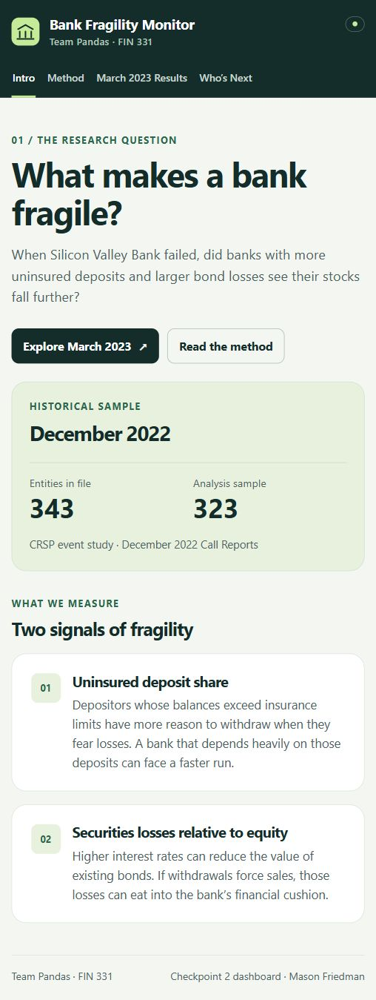

# Bank fragility during the SVB crisis

Team Pandas: Andrew Temo, Mason Friedman, Morgan Waddell, Ryan Carr
FIN 331 · Checkpoint 2 and HW8 · Due Saturday, November 14, 2026

## Question and value

Did listed banks with greater dependence on uninsured deposits and larger securities valuation losses experience worse stock returns during March 9–13, 2023? We will also build a transparent fragility screen and test whether measures available before the crisis identified banks that subsequently failed. Bank investors and regulators could use the analysis to compare exposures and identify cases for further investigation.

The project combines the course's event-study, data-linking, aggregation, regression, and reproducible-analysis methods. It measures associations during one crisis window; it does not identify a causal effect or promise to predict failures.

## A working small-sample v0

The team has also merged a canonical full-sample pipeline on main. This proposal documents the independently verified 20-bank Checkpoint 2 run, isolated under `code/checkpoint2/` and `data/processed/checkpoint2/`; it does not replace the full-sample scripts or their outputs.

One observation is one listed bank entity: a holding company or a standalone listed bank. The unique key for this development sample is `ticker`, with regulator identifier and CRSP PERMCO retained in the crosswalk. The current v0 covers 20 deliberately selected entities, including SVB, Signature, First Republic, PacWest, and Comerica. Thirty subsidiary-bank reports aggregate to those entities. It is not a random or representative sample.

Financial measures use December 31, 2022 reports. Prices/returns span January 2022–December 2023 in the supplied CRSP delivery. The event outcome covers March 9, 10, and 13, 2023. Eighteen banks have complete observed event outcomes; the other two retain explicit missing-outcome notes and separate zero-recovery scenarios. The broader NY Fed-linked universe contains 343 entities, including nonbank financial groups; eligibility and coverage must be reviewed before a full-sample expansion.

### Dataset columns and real rows

Required identifiers and variables are entity name, ticker, entity type and ID, report date, subsidiary count, assets, uninsured-deposit share, securities-loss ratios, event returns, estimation coverage, and missing-data notes. Subsidiary-bank financial amounts are summed before taking ratios. They are not automatically consolidated holding-company financial statements.

| Ticker | Assets (billion dollars) | Uninsured share | Baseline securities loss/equity | Market-adjusted BHAR |
|---|---:|---:|---:|---:|
| JPM | 3202.00 | 53.57% | 15.49% | -0.91% |
| WAL | 67.68 | 55.03% | 18.48% | -59.66% |
| ZION | 89.54 | 49.84% | 30.86% | -31.95% |
| SIVB | 209.03 | 93.88% | 114.42% | Missing |
| CMA | 85.61 | 62.48% | 62.15% | -32.95% |
| SBNY | 110.36 | 89.67% | 40.13% | Missing |

The table is generated from `outputs/checkpoint2_dataset.csv`; the complete file also contains HTM and AFS components, market-model CAR, estimation observations and return-source labels. Ratios above 100% of equity are possible. Missing outcomes are not zero.

## Inputs, sources and storage

| Input | Source and retrieval | Repository location |
|---|---|---|
| Pre-event bank financials | FDIC BankFind financials API; filters by report date and entity ownership | Downloaded by `01_download_fdic.py` into ignored `data/raw/` |
| Historical regulator–stock link | NY Fed CRSP–FRB September 2024 vintage; retain links active December 31, 2022 | `00_build_universe.py`; derived universe in `data/processed/` |
| Selected v0 crosswalk | Original six hand matches plus NY Fed identifiers matched to CRSP names on March 8, 2023; Signature CERT checked against returned report | `inputs/checkpoint2_crosswalk.csv` |
| Stock and market returns | Licensed CRSP/WRDS delivery pulled November 6, 2026; supplied by the professor through the user | Local-only `data/raw/crsp_delivery/ant728_request/` |
| Zions disclosures | 2022 Form 10-K filed February 23, 2023; sourced manual transcription, not invented observations | `inputs/zions_disclosures.csv` |

Raw CRSP data cannot be downloaded from the public repository. Authorized users must obtain the delivery and place it at the documented path. Only event-level derived results and diagnostics are distributed. `data/provenance_log.csv` records sources, retrieval/receipt times and vintages.

## Measures and analysis

- Uninsured-deposit share: `DEPUNINS / DEPDOM`, matching the domestic coverage of both fields. Log any missing subsidiary values and do not treat partial coverage as a complete estimate.
- Provisional securities exposure: `((SCHA-SCHF)+(SCAA-SCAF))/EQTOT`. HTM-only exposure remains an alternative. Require positive equity for ratio-based inference; inspect negative gaps rather than clipping them away.
- Transfer-aware definition: add the remaining pretax loss attached to AFS-to-HTM transfers. Morgan's [Zions note](docs/zions_measurement.md) explains the distinction between transfers, AOCI balances and OCI flows. The approximate disclosure-based diagnostic is not yet a cross-bank measure.
- Headline event outcome: `product(1+stock_total_return) - product(1+CRSP_VWRETD)`. Observed delisting returns are compounded with ordinary returns on the delisting date, not added. Unknown delisting returns stay unknown in the baseline. A terminal zero-value scenario is separately labeled for SVB and Signature; it is not CRSP evidence of actual recovery.
- Alternative outcome: summed market-model abnormal returns with estimation days [-250,-30] and at least 150 observations. CRSP VWRETD is the benchmark for both implementations.
- A first descriptive OLS regresses market-adjusted buy-and-hold returns on uninsured share and provisional securities-loss exposure with an intercept. It uses 18 complete outcomes. It establishes that the analysis runs, not reliable inference: failed-bank missingness and sample selection remain material.

### Reproducible pipeline

1. `code/checkpoint2/00_build_universe.py`: historical link universe and requested PERMCO list.
2. `code/checkpoint2/01_download_fdic.py`: report-date subsidiary financials for the selected v0.
3. `code/checkpoint2/crsp_returns.py`, called by `03_build_dataset.py`: validate CRSP keys/share-class uniqueness; construct returns and merge one-to-one with entity measures.
4. `code/checkpoint2/04_hand_checks.py`: independent aggregation, public-figure and return-arithmetic checks.
5. `code/checkpoint2/05_checkpoint_outputs.py`: sourced Zions diagnostic, descriptive regression and dashboard JSON.
6. `app/index.html`: render only generated public outputs. The app contains no raw-data credentials or CRSP daily rows.

Run `python run_checkpoint2.py` after installing requirements and placing licensed inputs locally. The old yfinance downloader is retained as development history; Checkpoint 2 uses CRSP and does not require it to produce returns.

## Threats and checks

| Threat | Response and remaining limitation |
|---|---|
| Failed banks disappear or have incomplete returns | Keep every sample row; show missing outcomes and a separate recovery scenario. Baseline OLS remains selected on outcome availability. |
| Misstated or later-amended financial data | Fix report quarter before the event and log API vintage. A 3–5-bank original FFIEC bulk-file comparison is still outstanding; no claim that it passed. |
| Accounting transfers mask earlier losses | Use sourced Zions reconciliation; distinguish after-tax AOCI balances from annual OCI flow. Full cross-bank transfer balances remain uncollected. |
| Entity matching and subsidiary coverage | Assert unique CERT, PERMCO and sample entity keys; validate one-to-one final merges. Manually review historical ownership and report names. |
| Benchmark, compounding and delisting errors | Independent scalar return multiplication; compound observed RET and DLRET; calendar uses market trading dates. |
| Selection, tiny sample and specification search | Label the selected v0 descriptive; report coverage; record every evaluated definition in `specs_tried.md`; no p-values or causal claims. |
| Licensed data exposed through the app | Raw files are ignored; daily CRSP returns never enter tracked outputs; preview serves an explicit public allowlist. |

See [self-audit and responses](audits/01_self_audit.md). Eight independent hand checks pass, plus Zions disclosure arithmetic and input/key assertions.

## Dashboard design

The four pages introduce the question, explain methodology, show event returns against uninsured share, and offer a searchable/sortable historical exposure table. Dot sizes represent assets and color distinguishes baseline securities exposure. Return definitions can be switched. The screen clearly states that December 2022 values are historical and that predictive validation has not been run.

## Historical validation plan

`specs_tried.md` records a retrospective test design before screen performance is calculated: freeze the eligible universe and consistent loss measure; flag the top 10% of the average of the two exposure percentile ranks; compare with later regulatory bank failures through December 2023; disclose exclusions and distinguish mergers from failures. The team already knows famous outcomes, so this is not an untouched prospective preregistration. A live latest-quarter screen and full-sample validation are extensions, not claimed Checkpoint 2 accomplishments.

## References

- [FDIC BankFind financials API](https://api.fdic.gov/banks/financials) and [field dictionary](https://api.fdic.gov/banks/docs/risview_properties.yaml).
- [NY Fed CRSP–FRB link](https://www.newyorkfed.org/research/banking_research/crsp-frb).
- [Zions 2022 Form 10-K](https://www.sec.gov/Archives/edgar/data/109380/000010938023000074/zions-20221231.htm), Notes 5 and 14.
- CRSP legacy daily stock and index files through Lehigh WRDS; provider's local delivery README and pull script document construction and licensing.
- [Federal Reserve SVB review](https://www.federalreserve.gov/publications/2023-April-SVB-Key-Takeaways.htm), used for a post-event validation check only, not a pre-event predictor.

## Assistance disclosure

Codex assisted with code, drafting, source lookup and checks. Every teammate must review and understand the final methods and implementation. Source inputs and analytical assumptions are documented separately from generated prose.
