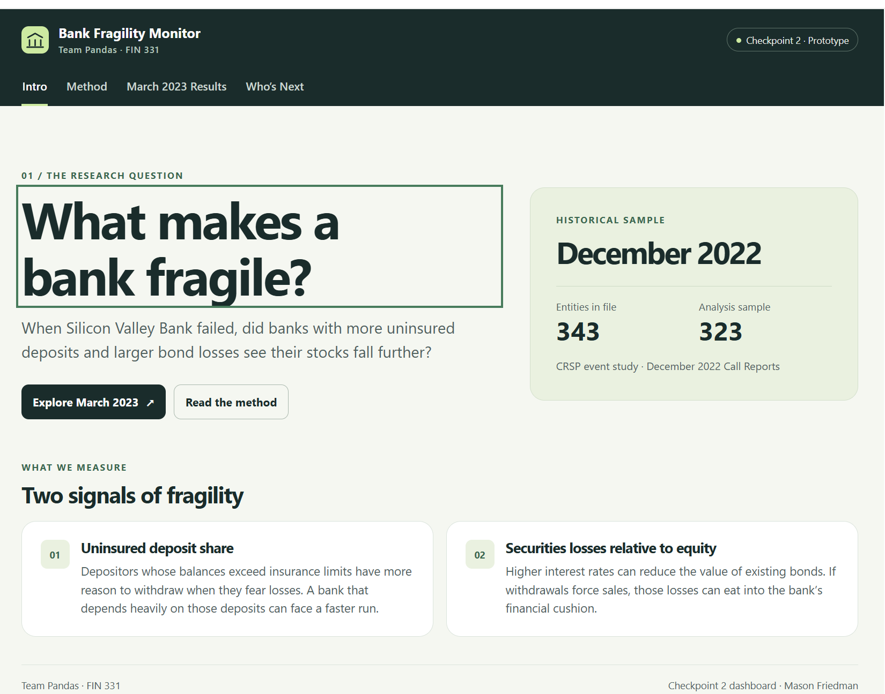
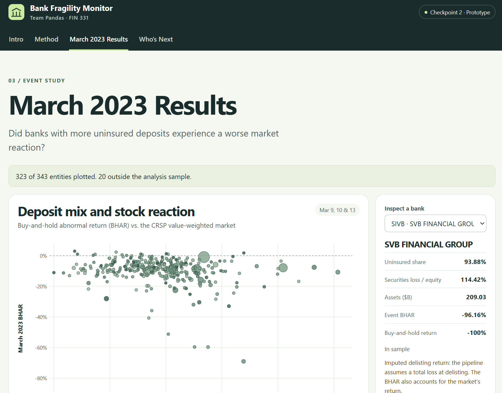
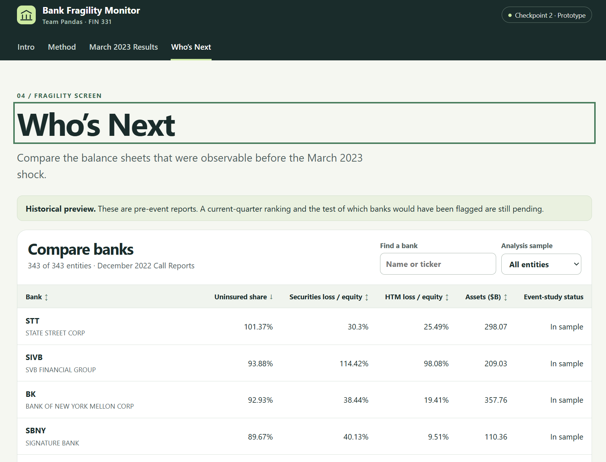

**Team Name:** Team Pandas  
**Team Members:** Andrew Temo, Mason Friedman, Ryan Carr, Morgan Waddell  

## Project Proposal Question

Who Ran After SVB? Uninsured deposits, and unrecognized bond losses, as drivers of Bank downturns/failures, and who’s next?

## Why do our results matter/who would pay for them? - Andrew Temo

Our results matter for a few different reasons. People look at their money as safe while in a bank, they trust that bank to hold their money until they withdraw it (expecting to get the full amount they want). However, that isn’t always the case. At an FDIC insured bank, your money is only safe up to $250,000. Anything over that is a risk for you, as you are not guaranteed any money over that $250,000 if the bank fails. As seen with SVB, sometimes banks make less than smart decisions and look to hide these decisions from the public through accounting methods like the “HTM distinction” . SVB was able to hide losses on some of its purchased bonds, by deeming them as “held-to-maturity” assets, which allowed them to list them and keep them as the purchase price on their balance sheet. Once this was exposed, many businesses pulled their money out causing a run on the bank and its eventual collapse. This study looks to see how uninsured deposits and unrecognized bond losses related to returns of banks during the period of SVB failure. We will further look to apply this data to see if you could have determined “who is next” after the SVB failure. A few different groups would pay for these results. Hedge funds or short sellers would pay to get future investment ideas. Other banks may pay to see where their competitors stand. Policy makers may pay in an effort to see what policy needs to be passed in order to prevent banks from failing.

## Method - Andrew Temo

Our ultimate goal with this project is to look at all banks and see whether those with more uninsured deposits and/or unrecognized bond losses fell more after SVB announced its big losses on its bonds on March 8th 2023. We will also then use these to rank “who’s next”. This takes a fair amount of steps from raw data. The steps we currently have in place and plan to use in our final submission as of today are:

1. We will pull a list of every publicly traded bank as of December 31, 2022 from the FED. The result is the names of 343 companies
2. Next using the companies names we pull each of their balance sheets from Dec 31, 2022 from the FDIC.
3. Professor Bowen provided us with CRSP, and to confirm we handle it right we also pull Y-finance stock prices on JPM, WAL, and ZION, to do some checks
4. Next, using the CRSP data Professor Bowen provided us with (since we cannot pull daily returns from March 2023, from banks that failed), we compute each Bank’s return over the event window we chose, which was March 9,10, and 13 2023 (since SVB announced the losses after market hours on March 8th 2023). We then compare this to the markets return over those three days (also pulled from CRSP), and subtract that from each banks return to get the abnormal return for each bank over the event period. Giving the banks that failed during the period a -100% delisting return (SVB and Signature).
5. Then, we link each company to the bank name (using ID numbers), since some show up differently in the names on the balance sheet we pulled from the FDIC , vs the company name on our returns data (e.g. JPMorgan & Chase Co. and Chase Bank vs. First Republic). When applicable, the banks’ numbers are summed up to the parent company. From here we compute uninsured deposit share (uninsured deposits/domestic deposits), HTM loss as a portion of equity ((book value-market value of HTM bonds)/equity), securities loss as a portion of equity ((book value-market value of HTM bonds+ AFS bonds)/equity, and log assets (log(total assets). Finally we attach the stock returns we calculated before to each company
6. Lastly we run our regression analysis. We run a few different regressions to answer different questions pertaining to our topic. For instance, some of the regressions we are going to run answer: Did banks with statistically more uninsured deposits fall more? Did banks with more unrecognized losses on HTM bonds fall more? We also look to answer questions about our method, such as: Does it matter how we measure bond losses? Do our results only rely on the banks that actually failed? Does it matter how we measured the crash?
7. From here we want to see if our findings could have been used before the next failures. We plan to measure the same statistics again using data as of Dec 31, 2022 (portion of uninsured deposits and total security losses as a portion of equity). These stats then become percent tiles and we then take the top 10%. We then check this top 10% against what happened after March 13, 2023 to see if the flagged bank failed or stock crashed, to help us answer whether one could have determined “who was next” after SVB.

This method fits our question because the balance sheets were public before the crash, so they are not a result of it. The three day window is done in an effort to prevent any other news affecting our returns, however the window does include the FED’s step in with SVB. More specifically, the first part looks to answer the question of what traits mattered (unrecognized bond losses or uninsured deposits). The second part looks to answer the question if you could have acted on them in advance (i.e., could you have determined who would be next).

## The Data - Ryan Carr

The unit of observation is firm. Each row represents one bank, usually a bank holding company, or the bank itself. Every row combines the Q4 2022 Bank Financials with its stock returns near the 2023 event. We aggregated FDIC call-report values across subsidiary banks, then linking those values to CRSP returns using its PERMCO.

We started off with 343 listed entities from the NY Fed CRSP-FRB link from 12/31/2022. Entities are included in the main analysis when it matches an FDIC record, an event-period return, and positive equity. 323 of the 343 entities meet all 3 requirements listed above. 16 of the excluded entities do not have an FDIC match, while four lacked an event-period return.

The main outcome is buy-and-hold abnormal return (bhar_0_2) over the three trading days. We find this by subtracting the CRSP weighted return from the compounded stock return over the same period. The table below shows four example rows from the dataset:

| Entity | FDIC banks summed | Assets ($B) | Uninsured deposit share | HTM loss/equity | Securities loss/equity | BHAR |
|---|---|---|---|---|---|---|
| Silicon Valley Bank (SIVB) | 1 | 209.026 | 93.9% | 0.981 | 1.144 | −96.2% |
| First Republic (FRC) | 1 | 212.639 | 67.7% | 0.273 | 0.300 | −69.0% |
| Western Alliance (WAL) | 1 | 67.684 | 55.0% | 0.031 | 0.185 | −59.7% |
| JPMorgan Chase (JPM) | 2 | 3,202.005 | 53.6% | 0.121 | 0.155 | −0.9% |

The key regression variables are bhar_0_2, uninsured_dep_share, htm_loss_to_equity and log_assets.

The table below shows our raw inputs, along with their source and location:

| Raw input | Source and retrieval | Location in repository |
|---|---|---|
| Listed-entity universe | NY Fed CRSP–FRB link; retrieved by pipeline step 00 | data/raw/nyfed_crsp_frb_link.csv; processed universe in data/processed/universe_20221231.csv |
| Bank financials and identifiers | FDIC BankFind financials and institutions APIs; retrieved by step 01 | data/raw/fdic_financials_20221231.csv and data/raw/fdic_institutions.csv |
| Stock, delisting, and market returns | Prof. Bowen’s CRSP WRDS pull for the 343 PERMCOs, covering January 2022–December 2023 | Four files in data/raw/crsp/; licensed for the team and not committed |
| FFIEC comparison data | FFIEC CDR Bulk Data, Call Reports—Single Period, report date 12/31/2022, Tab Delimited; downloaded manually | data/raw/ffiec_call_20221231.zip; used to cross-check FDIC fields |
| Price cross-check | yfinance adjusted closes for three banks; retrieved by step 02 | data/raw/prices_check.csv; cross-check only |

## Threats and checks - Morgan Waddell

There are many threats and risks associated with how our results will be interpreted. These can be limited through certain checks, assumptions and tests in order to ensure accuracy.

Look-ahead: we used predictions from the 2022 call reports in December that were made available before the March 2023 event in question. This helps keep other variables that happened after from interfering. It is important to understand that the FDIC API does give the current version of  the reports which may include modifications/revisions. Ryan Carr’s results showed all 24 field comparisons of the 4 banks matched accordingly to the FFIEC snapshot. This supports the consistencies from each source however due to their current nature they may alter from the original report.

Survivorship/missing returns: if we use banks whos history of their stock is only available today this can mean we miss the potential failures that are critical to our question. This is why we use CRSP and define it as such using historical data. Using CRSP can still miss delisting returns from SVB and Signature. We assume a baseline of -100% delisting return which shows us relying on an assumption rather than true values. Regression R3 does not include them as a robustness check. The uninsured deposits coefficient is smaller without then and changes our conclusion which can demonstrate the importance of these observations.

Entity merge: of the 343 linked entities only 327 match FDIC data and 323 reach the sample requirements. All other entities are visible but flagged. Call reports describe a bank where as stocks are with holding companies. If there are inaccurate matches or duplicates it may alter the exposure measures being used. This is why performing the pipeline to sort this issue by report-date holding-company identifiers is important.

P-Hacking: recognizing that return definitions, sample restrictions and loss measures can contribute to different results. We use the specification log documents, official regressions, and measurement choices so readers can see the alternatives rather than only a preferred result. Ryan has a “pre-specified out-of-sample fragility screening” section that records the screening preferences before calculation. The team already knows the crisis results therefore this becomes a retrospective tool opposed to a blind forecasting procedure.

LLM leakage: AI can know what banks failed, which can influence historical risk being used in assessment. Our team's event predictors are calculated from FDIC reports and not AI judgments. AI code and research still means independent verification is necessary at all times through checking sources, generated code, and unbiased assumptions that we did not give.

The Zionz measurement problem: Transferring securities can hide early losses. Our evaluation compares FDIC data with disclosures and separate securities losses from AOIC. We corrected EQCCOMPI to annual OCI flow opposed to accumulated AOCI. This new adjusted Zions Calculation will not change the actual regression.

The pipeline passes all 12 existing checks and the zions assertions. These “checks” help support accuracy in data analysis but cannot fully eliminate uncertainty about past data snapshots, missing delistings or interpretation from results.

## Dashboard - Mason Friedman

Live dashboard: https://ant728.github.io/Team-Pandas-Final/app/

The dashboard consists of four tabs. The Intro tab provides information about the research question and relevance of uninsured deposits and bond losses. The Method tab covers data, the event window, and abnormal return calculation for buy and hold abnormal returns. The March 2023 Results tab depicts the abnormal return versus share of uninsured deposits graph with dots sized by assets and colored by securities losses over equities. Users can choose a bank in order to examine its parameters. The Who’s Next tab allows the user to compare December 2022 balance sheet parameters for all the banks using a filterable table with explanations of banks' inclusion in the analysis sample.
