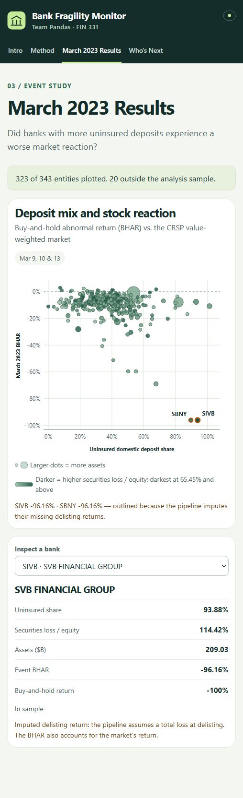

# Bank fragility: SVB and the banks that looked like it

**Team Pandas — Andrew Temo, Mason Friedman, Morgan Waddell, Ryan Carr**
FIN 331, Lehigh University · Proposal (HW8) and Checkpoint 2 · November 14, 2026

## The question and who would use the answer

When Silicon Valley Bank failed, did listed banks with more uninsured deposits and larger unrealized securities losses suffer greater stock declines? We study the market reaction during March 9–13, 2023, then propose a historical fragility screen using information available before the crisis. Bank investors and regulators could use the results to compare exposures and identify banks requiring closer investigation.

Uninsured deposits can leave quickly when confidence falls. Bond losses can weaken a bank's ability to meet those withdrawals without damaging equity. The combination motivates an event study and a cross-sectional regression. Our contribution is a transparent connection between reported accounting exposures and market outcomes, including the measurement problems created when securities move between accounting categories. The analysis describes associations, not causal effects or a guaranteed prediction of failure.

## Data and the observation

One row is one listed entity: a bank holding company or a standalone listed bank. `rssd_id` is the unique regulator key and `permco` is the unique CRSP company key. The historical NY Fed link identifies **343 entities** active on December 31, 2022. The final regression sample has **323 entities** with matched FDIC financials, observed or explicitly imputed event outcomes, and positive equity. Excluded entities remain in the output with coverage flags. We do not select banks based on survival to the present.

Balance-sheet measures use December 31, 2022 reports. CRSP daily stock and market data cover January 2022–December 2023. The event window is March 9, 10 and 13, 2023; the market-model estimation window is trading days −250 to −30, requiring at least 150 observations. Insured-bank financial amounts are summed across each listed entity's subsidiaries before ratios are calculated. These aggregates can differ from consolidated holding-company accounts.

### Real rows from the final dataset

| Ticker | Assets ($B) | Uninsured share | HTM loss/equity | BHAR | Imputed delisting? |
|---|---:|---:|---:|---:|---|
| SIVB | 209.03 | 93.88% | 98.08% | -96.16% | Yes |
| SBNY | 110.36 | 89.67% | 9.51% | -96.16% | Yes |
| JPM | 3202.00 | 53.57% | 12.09% | -0.91% | No |
| WAL | 67.68 | 55.03% | 3.09% | -59.66% | No |
| ZION | 89.54 | 49.84% | -2.31% | -31.95% | No |

Source: [`outputs/final_dataset.csv`](outputs/final_dataset.csv). BHAR is `bhar_0_2`, the stock's compounded return minus the CRSP value-weighted market's compounded return. SVB and Signature's delisting outcomes use the explicit loss assumption described below.

Necessary columns include `rssd_id`, `permco`, `ticker`, `name`, `total_assets_bn`, `log_assets`, `uninsured_dep_share`, `htm_loss_to_equity`, `sec_loss_to_equity`, `bhar_0_2`, and the `has_fdic`, `has_returns`, `positive_equity`, `in_sample` and `dlret_imputed` flags. Additional diagnostics include `car_0_2`, estimation coverage, subsidiary counts, uninsured-reporting coverage and `oci_2022_to_equity`. Exact remaining transfer-loss balances and a latest-quarter screen are desired extensions; marking the loan book to market is not required for the main analysis.

### Raw inputs and storage

| Input | Source and acquisition | Location |
|---|---|---|
| Historical listed-entity universe | NY Fed CRSP–FRB link; download and keep links active at the report date | Raw link in ignored `data/raw/`; derived universe in `data/processed/` |
| Quarterly bank financials and regulator IDs | FDIC BankFind financials and institutions APIs; paginated download | Ignored `data/raw/fdic_financials_20221231.csv` and `data/raw/fdic_institutions.csv` |
| Daily returns, market returns and delistings | Professor-supplied CRSP/WRDS delivery through Lehigh | Four licensed CSVs in ignored `data/raw/crsp/`; event-day intermediate files in ignored `data/interim/` |
| Independent price check | yfinance adjusted prices for the banks named in the hand checks | Ignored `data/raw/prices_check.csv` |
| Sourced Zions disclosures | Manual transcription from the pre-event annual report, with public date and location | `inputs/zions_disclosures.csv` |

Licensed CRSP rows are never distributed in the public repository or dashboard. Authorized users obtain the inputs from the professor's shared folder. The source log is `data/provenance_log.csv`; public outputs contain computed results rather than daily CRSP records.

## Measures and the method

Uninsured exposure is estimated uninsured domestic deposits divided by domestic deposits. Where the reported estimate is absent, the pipeline uses the documented large-account approximation; its agreement with reported estimates is checked. Securities exposure is either the HTM amortized-cost/fair-value gap divided by equity or the combined HTM and AFS gap divided by equity. `oci_2022_to_equity` is an annual OCI flow diagnostic, not accumulated AOCI and not a regression predictor.

The main outcome is buy-and-hold abnormal return:

`bhar_0_2 = product(1 + bank total return) − product(1 + CRSP VW market return)`

Observed delisting returns are compounded with ordinary returns on their dates. The official baseline sets SVB and Signature's missing delisting returns to −100%, as recorded in specification #5. This is an assumption, not an observed recovery value. R3 excludes those entities to show the dependence on that assumption. We preserve this single official policy rather than publish competing baseline datasets.

The baseline regression relates BHAR to uninsured share, HTM loss/equity and log assets, with heteroskedasticity-robust HC3 standard errors. R2 substitutes total securities losses, R3 removes the two imputed cases, and R4 uses market-model CAR. All variants are logged in `specs_tried.md`.

### Reproducible pipeline

Run `python run_all.py` from the repository root after installing `requirements.txt` and placing the licensed inputs locally.

| Step | Script | Purpose |
|---|---|---|
| 00 | `code/00_build_universe.py` | Form the report-date listed-entity universe |
| 01 | `code/01_download_fdic.py` | Download financials and bank ID mappings |
| 02 | `code/02_download_prices.py` | Obtain independent price cross-checks |
| 03 | `code/03_crsp_returns.py` | Construct CRSP event outcomes and delisting flags |
| 04 | `code/04_build_dataset.py` | Aggregate subsidiaries and merge the final entity dataset |
| 05 | `code/05_regressions.py` | Produce regression tables and descriptive statistics |
| 06 | `code/06_hand_checks.py` | Recompute key amounts independently |
| 07 | `code/07_zions_reconciliation.py` | Reconcile sourced Zions disclosures and write accounting diagnostics |

### What the working results show

| Model | N | Uninsured-share coefficient | p-value | R-squared |
|---|---:|---:|---:|---:|
| R1 | 323 | -0.1506 | 0.030 | 0.175 |
| R2 | 323 | -0.1643 | 0.025 | 0.166 |
| R3 | 321 | -0.0620 | 0.051 | 0.116 |
| R4 | 322 | -0.2014 | 0.032 | 0.151 |

Source: [`outputs/regressions_v0.md`](outputs/regressions_v0.md), with machine-readable coefficients in [`outputs/regressions_v0.csv`](outputs/regressions_v0.csv). R1 is the baseline, R2 changes the loss measure, R3 excludes the imputed failures, and R4 changes the return outcome.

The uninsured-deposit association weakens markedly when the imputed failures are removed. This sensitivity is central to interpretation. The current results do not establish that the bond-loss measures independently explain the crisis reaction. Average sample BHAR is **-10.34%**, from [`outputs/summary_stats.csv`](outputs/summary_stats.csv); it describes this event and sample, not a general forecast.

## Accounting contribution: the Zions puzzle

The [Zions measurement note](docs/zions_measurement.md) explains why a negative current HTM gap does not imply that earlier losses disappeared. AFS-to-HTM transfers can leave earlier losses in accumulated other comprehensive income while resetting the HTM basis. The recommended exposure definition includes the remaining pretax transferred securities loss alongside the current gaps, with taxes and non-securities components handled separately. The generated comparison is explicitly approximate and does not change the official regressions. It is reported in [`outputs/zions_measure_comparison.csv`](outputs/zions_measure_comparison.csv), with sources and checks in [`outputs/zions_reconciliation.csv`](outputs/zions_reconciliation.csv).

## Threats and checks

| Threat | Check or response; remaining limitation |
|---|---|
| Missing failed-bank delisting values | Explicit baseline imputation and R3 exclusion sensitivity; imputed points are labeled in the dashboard |
| Later-amended historical reports | Fix the reporting quarter and log API vintage; the FDIC API versus FFIEC bulk-file check is in progress in Ryan’s PR |
| Transfers, taxes and OCI/AOCI confusion | Separate sourced Zions reconciliation; correctly label the OCI flow; do not gross up total AOCI or assume all of it is bond losses |
| Different business models and extreme ratios | Disclose custody-bank deposit composition and thin-equity outliers; do not choose winsorization after seeing preferred results |
| Entity matching and incomplete coverage | Assert unique keys and merge cardinality; retain excluded entities and flags; some bank/parent links remain imperfect |
| Illiquid stocks and crisis confounds | Disclose price quality and the broad crisis window; avoid causal language |
| Specification search | Log every specification and freeze screen definitions before computing performance |
| Reproduction and licensing | One official pipeline, generated public outputs and an allowlisted dashboard server; licensed raw inputs remain local |

The official hand-check report contains **9 passing checks**: published SVB magnitudes, subsidiary aggregation, uninsured approximation, independent stock-return comparisons, CRSP compounding and the baseline delisting assumption. Step 07 adds disclosure-rounding and AOCI-component checks. Sources: [`outputs/hand_checks.md`](outputs/hand_checks.md), the reconciliation outputs, and [self-audit](audits/01_self_audit.md). The assumption check verifies arithmetic, not the recovery assumption's truth. Friday's full team skeptical review remains scheduled.

## Dashboard and proposed screen

Mason's dashboard reads only `outputs/final_dataset.csv`. Intro explains the question; Method documents the data and event; March 2023 Results plots BHAR against uninsured share, with assets and securities losses encoded visually; Who's Next provides a searchable and sortable historical table with inclusion flags. Start it with `python app/serve.py` and open the local address printed by the server.

## Historical validation plan

Ryan's historical validation test will assess whether pre-event fragility measures flagged banks that subsequently got into trouble; its rules belong in the [Pre-specified out-of-sample fragility screen](specs_tried.md#pre-specified-out-of-sample-fragility-screen) section of `specs_tried.md`, supplied by his PR. The historical dashboard is not a validated live prediction.

## Sources and assistance

Data sources: [FDIC BankFind](https://api.fdic.gov/banks/financials), [FDIC definitions](https://api.fdic.gov/banks/docs/risview_properties.yaml), [NY Fed CRSP–FRB link](https://www.newyorkfed.org/research/banking_research/crsp-frb), licensed CRSP/WRDS through Lehigh, and the sourced filings linked in the Zions note. Post-event published SVB figures are used only for validation, not as pre-event predictors.

Codex assisted with code, source lookup, drafting and verification. Morgan's contribution covers Zions measurement, the OCI label correction, the proposal and audit additions. Every teammate must review and be able to explain the pipeline and assumptions.
