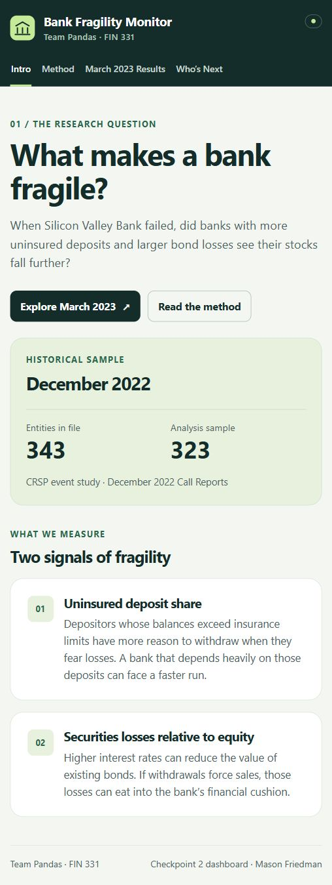
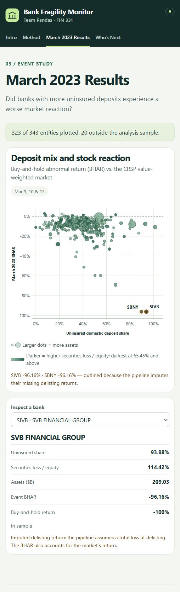

# Mason Friedman — HW8 dashboard handoff

Verified November 12, 2026.

**[Open the live dashboard](https://ant728.github.io/Team-Pandas-Final/app/)**

## Mockups

These screenshots show the working dashboard with the official
`outputs/final_dataset.csv`. They are the same images already linked from
the proposal draft in PR #8.

### Intro



### March 2023 results



## Page facts for Mason's own proposal paragraph

| Page | What is on it | What to explain in your own words |
|---|---|---|
| Intro | The research question, two fragility measures, and sample coverage | Why someone should care about the comparison |
| Method | December 2022 Call Reports; March 9, 10, and 13 event window; FDIC and CRSP; compounded BHAR; the delisting assumption | How pre-event measures are connected to event returns |
| March 2023 Results | Uninsured deposit share against BHAR; assets determine dot size; securities losses determine color; a bank inspector; outlined imputed failures | What a reader can learn by exploring the chart, and why the imputation labels matter |
| Who's Next / Explore | Search, numeric sorting, and sample filters for the historical bank table | How a reader compares banks, and that this is not a current-quarter ranking or a validated failure forecast |

## Proposal integration

In PR #8, the root-level `PROPOSAL.md` already links the images under
“Dashboard and proposed screen.” These paths resolve from the repository root:

```markdown
[Live dashboard](https://ant728.github.io/Team-Pandas-Final/app/)


```

The assignment sheet asks each teammate to write the proposal paragraph in
their own words in the shared document. This guide supplies page facts,
not a replacement paragraph. Andrew owns the final proposal integration.

## Formatting and fact checks for the final edit

- Both existing screenshot images load in GitHub's rendered PR #8 proposal.
- The proposal's five tables render, and its local linked files exist on that branch.
- Add a blank line between the team line and the course line in the proposal header so they appear as separate paragraphs.
- Ryan's FDIC/FFIEC comparison is now merged in PR #10: all 24 comparisons matched. It compares current snapshots, not original filing vintages.
- Ryan's screen rules are now in `specs_tried.md`. The rules are written; the screening results have not been calculated or validated.
- The Zions Step 07 and corrected OCI field belong to PR #8 until that work is merged. Keep that distinction when describing the pipeline.
- The team still needs to choose the one final Checkpoint 2 PR submitted on CourseSite. This handoff is a contribution to that submission.

## Public-site verification

Opened all four pages on GitHub Pages. The Intro displayed 343 entities and
323 analysis rows. The results chart contained 323 points and two imputed
delisting markers. The historical table showed all 343 entities; its
in-sample filter and ticker search worked. The browser reported no console
errors or warnings during those checks.

The site uses only the published per-entity dataset. It does not fetch
licensed raw or row-level interim CRSP records.
